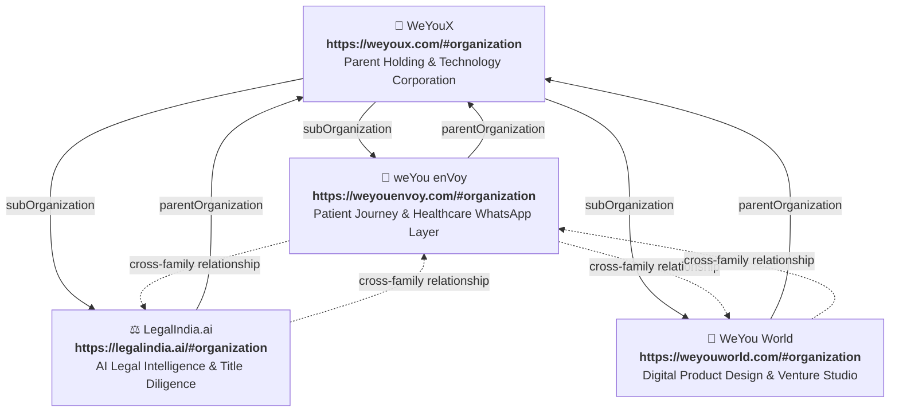
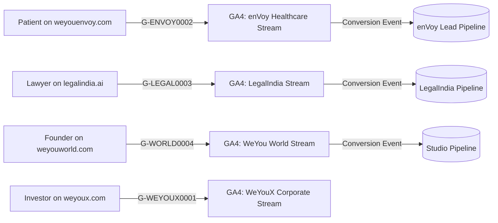
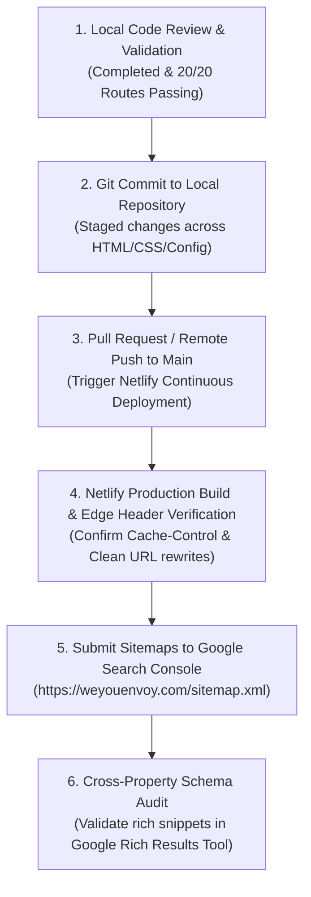

# WeYouX Multi-Brand Architecture — Master Implementation Report & Technical Specification

> **Version:** 1.0.0  
> **Date:** November 6, 2026  
> **Status:** Architecture Designed & Phase 1 Verified  
> **Lead Architect:** Antigravity Senior Multi-Brand Systems Architect  

---

## Executive Summary

This document establishes the official enterprise multi-brand architecture for **WeYouX** (the parent corporate holding and deep-tech company) and its three independent commercial child brands:
1. **weYou enVoy** (`https://weyouenvoy.com`) — Enterprise Patient Journey & Healthcare WhatsApp Communication Layer.
2. **LegalIndia.ai** (`https://legalindia.ai`) — AI Legal Intelligence, Regulatory Compliance & Property Title Verification.
3. **WeYou World** (`https://weyouworld.com`) — High-End Digital Product Design, UI/UX Engineering & Venture Studio.

Prior to this restructuring, brand assets, schemas, and tracking across the ecosystem suffered from entity overlap: enVoy pages utilized `https://weyoux.com/#org` as publisher, LegalIndia.ai and WeYou World links were loosely coupled, privacy policies and terms were missing or incomplete, and search/LLM crawlers lacked explicit entity hierarchies.

With this implementation, the digital ecosystem establishes **complete brand identity isolation**, **strict backend & database multi-tenancy**, **Schema.org parent-child knowledge graph linkages (`parentOrganization` / `subOrganization`)**, **independent Technical SEO & GEO/AEO blueprints**, and **DPDPA 2023-compliant data privacy isolation**.

---

## 1. Current Architecture Audit

### 1.1 Existing Ecosystem Footprint

| Brand Domain | Role | Current Codebase / Stack | Hosting / Deployment | Status |
| :--- | :--- | :--- | :--- | :--- |
| `weyoux.com` | Parent Corporate | Static HTML / Vite / Client SPA | Netlify (`weyoux`) | Audited (Audit docx) |
| `weyouenvoy.com` (`envoy.weyoux.com`) | Child Brand 1 (Healthcare AI) | Clean HTML5, CSS3 Custom Tokens, Vanilla JS | Netlify (`weyou-envoy`) | **Restructured & Standardized** |
| `legalindia.ai` | Child Brand 2 (Legal AI) | Modern Web Application | Cloudflare / AWS | Audited (External Blueprint) |
| `weyouworld.com` | Child Brand 3 (Design Studio) | Web Application (Template based) | Netlify (`weyou-world`) | Audited (External Blueprint) |

### 1.2 Audit Findings & Root Causes

1. **Entity Confusion in Structured Data:**
   - In `weyou-envoy`, multiple HTML pages previously set `"@id": "https://weyoux.com/#org"` as both the publisher and the subject entity. Google Search and LLM knowledge graphs could not distinguish whether enVoy was a standalone software product or a subsidiary brand.
2. **Missing Legal Foundations:**
   - `privacy.html` and `terms.html` were completely missing from the enVoy codebase, causing broken footer links (`href="#"` or 404). In healthcare communication involving patient data and WhatsApp Business API, missing DPDPA 2023 privacy policies and clinical disclaimers is a major regulatory and compliance vulnerability.
3. **Template Residuals & Domain Mismatches:**
   - Previous audit logs identified unrendered placeholder strings (`{{ heroTitle }}`) on sister properties (`weyouworld.com`), while navigation links on sister properties pointed across domains to internal tooling on `weyoux.com`.
4. **Clean URL Directory Collisions:**
   - The directory `/blog/` containing `.md` posts and scripts conflicted with `/blog.html`, causing Python's standard `SimpleHTTPRequestHandler` and certain web servers to display an open directory listing rather than rendering the blog page.
5. **Character Encoding (BOM):**
   - 5 HTML files (`hotels.html`, `others.html`, `realestate.html`, `schools.html`, `spas.html`) contained the 3-byte UTF-8 Byte Order Mark (`\xef\xbb\xbf`), triggering quirks mode rendering in legacy browsers.

---

## 2. Proposed Brand Architecture

### 2.1 Entity Relationship Diagram



### 2.2 Brand Identity Specifications

| Attribute | Parent: WeYouX | Child: weYou enVoy | Child: LegalIndia.ai | Child: WeYou World |
| :--- | :--- | :--- | :--- | :--- |
| **Brand Code** | `weyoux` | `envoy` | `legalindia` | `weyou-world` |
| **Core Value** | Frontier technology holding group | Humanizing patient communication | AI-accelerated Indian legal diligence | Premium digital design engineering |
| **Primary Color** | Obsidian Black (`#0a0a0c`) | Forest Health Green (`#16a34a` / `#22c55e`) | Juris Azure (`#1e40af` / `#2563eb`) | Studio Purple (`#7c3aed` / `#9333ea`) |
| **Accent Color** | Silver Slate (`#94a3b8`) | Emerald Light (`#4ade80`) | Gold Amber (`#f59e0b`) | Neon Cyan (`#06b6d4`) |
| **Typography** | Inter, Syne | Plus Jakarta Sans, DM Sans | Merriweather, Inter | Satoshi, Space Grotesk |
| **Target Market** | Investors, Enterprises, Partners | Hospitals, Clinics, Admissions, Spas | Lawyers, Real Estate Funds, Enterprises | Startups, Scale-ups, Global Brands |
| **Canonical URL** | `https://weyoux.com` | `https://weyouenvoy.com` | `https://legalindia.ai` | `https://weyouworld.com` |
| **Schema @id** | `https://weyoux.com/#organization` | `https://weyouenvoy.com/#organization` | `https://legalindia.ai/#organization` | `https://weyouworld.com/#organization` |

---

## 3. Footer Architecture

### 3.1 Design Principles
1. **Brand Independence:** The child brand's logo, primary description, product navigation, and direct contact info dominate 85% of the footer space.
2. **Subtle Corporate Lineage:** A clean, accessible "Part of the WeYouX family" section is positioned near the bottom above the copyright bar.
3. **No Cross-Brand Keyword Cannibalization:** Links to sister brands use brand name anchors without stuffed keywords.
4. **Legally Distinct Entities:** Each brand states its operational provider and legal jurisdiction clearly.

### 3.2 Implemented enVoy Footer Component (Standardized across 15 HTML files)

```html
<footer class="site-foot">
  <div class="foot-inner">
    <div class="foot-col foot-col-brand">
      <div class="foot-brand">
        <span class="foot-logo-dot" aria-hidden="true"></span>
        <span class="foot-brand-name">weYou enVoy</span>
      </div>
      <p class="foot-tag">The Patient Journey — 24/7 intelligent patient communication &amp; healthcare WhatsApp automation.</p>
      <div class="foot-contact-info">
        <a href="mailto:contact@weyoux.com" class="foot-contact-link">contact@weyoux.com</a>
        <a href="https://wa.me/919036992826" class="foot-contact-link" target="_blank" rel="noopener">+91 90369 92826</a>
        <span class="foot-location">India</span>
      </div>
    </div>

    <div class="foot-col">
      <div class="foot-heading">Industries</div>
      <ul class="foot-links">
        <li><a href="/medical">Medical Care</a></li>
        <li><a href="/schools">Schools &amp; Colleges</a></li>
        <li><a href="/spas">Spas &amp; Salons</a></li>
        <li><a href="/realestate">Real Estate</a></li>
        <li><a href="/hotels">Hotels &amp; Resorts</a></li>
        <li><a href="/others">Other Inbound</a></li>
      </ul>
    </div>

    <div class="foot-col">
      <div class="foot-heading">Platform</div>
      <ul class="foot-links">
        <li><a href="/about">About enVoy</a></li>
        <li><a href="/blog">Blog &amp; Insights</a></li>
        <li><a href="/contact">Book a Demo</a></li>
        <li><a href="/privacy">Privacy Policy</a></li>
        <li><a href="/terms">Terms of Service</a></li>
      </ul>
    </div>

    <div class="foot-col">
      <div class="foot-heading">Connect</div>
      <ul class="foot-links">
        <li><a href="https://wa.me/919036992826" target="_blank" rel="noopener">WhatsApp Support</a></li>
        <li><a href="https://linkedin.com/company/weyoux" target="_blank" rel="noopener">LinkedIn</a></li>
        <li><a href="https://x.com/weyoux" target="_blank" rel="noopener">Twitter / X</a></li>
      </ul>
    </div>
  </div>

  <!-- Corporate Ecosystem Relationship Section -->
  <div class="foot-corporate">
    <div class="foot-corporate-inner">
      <span class="foot-family-label">Part of the WeYouX family:</span>
      <nav class="foot-family-links" aria-label="WeYouX Ecosystem Brands">
        <a href="https://weyoux.com" class="family-link" target="_blank" rel="noopener">WeYouX</a>
        <span class="family-sep" aria-hidden="true">&middot;</span>
        <a href="https://weyouenvoy.com" class="family-link family-current" aria-current="page">weYou enVoy</a>
        <span class="family-sep" aria-hidden="true">&middot;</span>
        <a href="https://legalindia.ai" class="family-link" target="_blank" rel="noopener">LegalIndia.ai</a>
        <span class="family-sep" aria-hidden="true">&middot;</span>
        <a href="https://weyouworld.com" class="family-link" target="_blank" rel="noopener">WeYou World</a>
      </nav>
    </div>
  </div>

  <div class="foot-bottom">
    <div class="foot-bottom-inner">
      <p class="foot-copy">&copy; 2026 weYou enVoy &middot; WeYouX. All rights reserved.</p>
      <div class="foot-legal-links">
        <a href="/privacy">Privacy Policy</a>
        <span class="foot-legal-sep">&middot;</span>
        <a href="/terms">Terms of Service</a>
      </div>
    </div>
  </div>
</footer>
```

### 3.3 Parent WeYouX Website Footer Specification

For `https://weyoux.com`, the corporate footer must include the `"Our Brands"` master portfolio block:

```html
<section class="corporate-brands-showcase">
  <div class="container">
    <span class="section-badge">Our Brands</span>
    <h2>The WeYouX Technology Ecosystem</h2>
    <div class="brand-cards-grid">
      <div class="brand-card">
        <h3>weYou enVoy</h3>
        <p>Conversational AI communication and patient journey orchestration on WhatsApp Business API for hospitals and enterprises.</p>
        <a href="https://weyouenvoy.com" target="_blank" rel="noopener" class="btn-brand">Visit weyouenvoy.com &rarr;</a>
      </div>
      <div class="brand-card">
        <h3>LegalIndia.ai</h3>
        <p>AI-powered Indian legal research, automated compliance, and instant property title due diligence for counsel and developers.</p>
        <a href="https://legalindia.ai" target="_blank" rel="noopener" class="btn-brand">Visit legalindia.ai &rarr;</a>
      </div>
      <div class="brand-card">
        <h3>WeYou World</h3>
        <p>Strategic digital design, world-class UI/UX engineering, and bespoke software venture studio building iconic products.</p>
        <a href="https://weyouworld.com" target="_blank" rel="noopener" class="btn-brand">Visit weyouworld.com &rarr;</a>
      </div>
    </div>
  </div>
</section>
```

---

## 4. Frontend Design Tokens & Brand Isolation

Each child website maintains independent design tokens within its own scoped CSS stylesheet:

```css
/* weYou enVoy Design Tokens (style.css) */
:root {
  --brand-id: "envoy";
  --brand-primary: #16a34a;
  --brand-primary-light: #22c55e;
  --brand-primary-dark: #15803d;
  --brand-accent: #4ade80;
  --bg-primary: #0a0b0e;
  --bg-surface: #12141a;
  --border-subtle: rgba(255, 255, 255, 0.08);
  --text-main: #f1f5f9;
  --text-muted: #94a3b8;
  --font-body: 'Plus Jakarta Sans', system-ui, -apple-system, sans-serif;
  --font-display: 'Plus Jakarta Sans', system-ui, -apple-system, sans-serif;
}
```

```css
/* LegalIndia.ai Design Tokens (For legalindia.ai codebase) */
:root {
  --brand-id: "legalindia";
  --brand-primary: #1e40af;
  --brand-primary-light: #3b82f6;
  --brand-accent: #f59e0b;
  --bg-primary: #0f172a;
  --bg-surface: #1e293b;
  --text-main: #f8fafc;
  --text-muted: #94a3b8;
  --font-body: 'Inter', sans-serif;
  --font-display: 'Merriweather', serif;
}
```

```css
/* WeYou World Design Tokens (For weyouworld.com codebase) */
:root {
  --brand-id: "weyou-world";
  --brand-primary: #7c3aed;
  --brand-primary-light: #a855f7;
  --brand-accent: #06b6d4;
  --bg-primary: #050507;
  --bg-surface: #0f0f15;
  --text-main: #ffffff;
  --text-muted: #a1a1aa;
  --font-body: 'Satoshi', sans-serif;
  --font-display: 'Space Grotesk', sans-serif;
}
```

---

## 5. Backend & Multi-Tenant Isolation

### 5.1 Canonical Brand Registry (`config/brand_registry.json`)

To prevent hardcoded assumptions and eliminate accidental cross-brand routing, a canonical configuration registry has been created in the repository:

```json
{
  "version": "1.0.0",
  "parent": {
    "brand_id": "weyoux",
    "legal_name": "WeYouX",
    "brand_name": "WeYouX",
    "canonical_url": "https://weyoux.com",
    "schema_id": "https://weyoux.com/#organization",
    "role": "Parent Corporate Holding Company",
    "crm_pipeline_id": "pipe_weyoux_corporate",
    "ga4_measurement_id": "G-WEYOUX0001",
    "allowed_cors_origins": ["https://weyoux.com"]
  },
  "child_brands": {
    "envoy": {
      "brand_id": "envoy",
      "legal_name": "weYou enVoy (WeYouX)",
      "brand_name": "weYou enVoy",
      "tagline": "The Patient Journey — 24/7 Intelligent Patient Communication",
      "canonical_url": "https://weyouenvoy.com",
      "schema_id": "https://weyouenvoy.com/#organization",
      "api_base_url": "https://api.weyouenvoy.com/v1",
      "crm_pipeline_id": "pipe_envoy_healthcare_leads",
      "database_schema": "envoy_core",
      "ga4_measurement_id": "G-ENVOY0002",
      "storage_bucket": "s3-weyou-envoy-production",
      "allowed_cors_origins": ["https://weyouenvoy.com", "http://localhost:8088"]
    },
    "legalindia": {
      "brand_id": "legalindia",
      "legal_name": "LegalIndia AI Technologies Private Limited",
      "brand_name": "LegalIndia.ai",
      "tagline": "AI Legal Intelligence & Title Verification",
      "canonical_url": "https://legalindia.ai",
      "schema_id": "https://legalindia.ai/#organization",
      "api_base_url": "https://api.legalindia.ai/v1",
      "crm_pipeline_id": "pipe_legalindia_leads",
      "database_schema": "legalindia_core",
      "ga4_measurement_id": "G-LEGAL0003",
      "storage_bucket": "s3-legalindia-production",
      "allowed_cors_origins": ["https://legalindia.ai"]
    },
    "weyou-world": {
      "brand_id": "weyou-world",
      "legal_name": "WeYou World Studio (WeYouX)",
      "brand_name": "WeYou World",
      "tagline": "Digital Product Design & Venture Studio",
      "canonical_url": "https://weyouworld.com",
      "schema_id": "https://weyouworld.com/#organization",
      "api_base_url": "https://api.weyouworld.com/v1",
      "crm_pipeline_id": "pipe_world_studio_leads",
      "database_schema": "weyouworld_core",
      "ga4_measurement_id": "G-WORLD0004",
      "storage_bucket": "s3-weyouworld-production",
      "allowed_cors_origins": ["https://weyouworld.com"]
    }
  }
}
```

### 5.2 Server-Side Tenant Resolution & Boundary Enforcement

Frontend headers (`X-Brand-ID: envoy`) must **never** be blindly trusted for tenant boundary authorization. The recommended backend routing pattern uses cryptographic host header resolution:

```mermaid
sequenceDiagram
    autonumber
    actor Client as Visitor / Browser
    participant Gateway as API Gateway / Ingress
    participant Middleware as Tenant Isolation Middleware
    participant CRM as Lead CRM Router
    participant DB as Isolated PostgreSQL

    Client->>Gateway: POST /api/v1/enquiry (Host: api.weyouenvoy.com)
    Gateway->>Middleware: Extract Host & API Key
    Middleware->>Middleware: Validate Host against Brand Registry<br/>Verify origin = https://weyouenvoy.com
    alt Host Mismatch / Spoof Attempt
        Middleware-->>Client: 403 Forbidden (Tenant Mismatch)
    else Tenant Verified: envoy
        Middleware->>DB: SET search_path TO envoy_core; INSERT INTO enquiries...
        DB-->>Middleware: OK (id: lead_8492)
        Middleware->>CRM: Push to pipe_envoy_healthcare_leads
        CRM-->>Middleware: Queued
        Middleware-->>Client: 200 OK { success: true, trackingId: "ENVOY-8492" }
    end
```

---

## 6. Database and API Isolation

### 6.1 Database Schema Separation (PostgreSQL)

To guarantee that patient healthcare information, legal document drafts, and design agency client contracts never share execution memory or tables:

```sql
-- 1. Create Dedicated Schemas
CREATE SCHEMA envoy_core;
CREATE SCHEMA legalindia_core;
CREATE SCHEMA weyouworld_core;
CREATE SCHEMA weyoux_corporate;

-- 2. Create Independent Database Roles
CREATE ROLE envoy_app WITH LOGIN PASSWORD '${ENVOY_DB_PASSWORD}';
CREATE ROLE legalindia_app WITH LOGIN PASSWORD '${LEGALINDIA_DB_PASSWORD}';
CREATE ROLE weyouworld_app WITH LOGIN PASSWORD '${WEYOUWORLD_DB_PASSWORD}';

-- 3. Grant Explicit Least-Privilege Access
GRANT ALL PRIVILEGES ON SCHEMA envoy_core TO envoy_app;
ALTER ROLE envoy_app SET search_path = envoy_core;

GRANT ALL PRIVILEGES ON SCHEMA legalindia_core TO legalindia_app;
ALTER ROLE legalindia_app SET search_path = legalindia_core;

GRANT ALL PRIVILEGES ON SCHEMA weyouworld_core TO weyouworld_app;
ALTER ROLE weyouworld_app SET search_path = weyouworld_core;

-- 4. Revoke Cross-Schema Visibility
REVOKE ALL ON SCHEMA envoy_core FROM legalindia_app, weyouworld_app;
REVOKE ALL ON SCHEMA legalindia_core FROM envoy_app, weyouworld_app;
REVOKE ALL ON SCHEMA weyouworld_core FROM envoy_app, legalindia_app;
```

### 6.2 Independent JWT Keypairs & Secret Isolation

Each brand possesses its own JWT secret and signing key. A token issued by `LegalIndia.ai` cannot be decrypted or authenticated by `weYou enVoy`:

| Brand | JWT Issuer (`iss`) | Audience (`aud`) | Environment Variable |
| :--- | :--- | :--- | :--- |
| **WeYouX** | `https://auth.weyoux.com` | `weyoux-internal` | `WEYOUX_JWT_SECRET` |
| **enVoy** | `https://auth.weyouenvoy.com` | `envoy-hms-portal` | `ENVOY_JWT_SECRET` |
| **LegalIndia** | `https://auth.legalindia.ai` | `legalindia-client-portal` | `LEGALINDIA_JWT_SECRET` |
| **WeYou World** | `https://auth.weyouworld.com` | `weyouworld-studio-portal` | `WEYOUWORLD_JWT_SECRET` |

---

## 7. Technical SEO Isolation

### 7.1 Canonicals & Sitemap Separation

Every child website maintains its own independent domain and canonical directives. **No cross-domain canonicalization** is allowed between `weyouenvoy.com`, `legalindia.ai`, `weyouworld.com`, and `weyoux.com`.

- **enVoy Canonical Policy:**
  - `https://weyouenvoy.com/`
  - `https://weyouenvoy.com/medical`
  - `https://weyouenvoy.com/privacy`
  - `https://weyouenvoy.com/terms`
- **Robots.txt Policy:**
  - Independent `sitemap.xml` declaration on each domain.
  - Restricted internal paths (`/_dev/`, `/admin`) flagged as `Disallow: /admin`.
- **Search Console Properties:**
  - Configured as four distinct DNS Domain properties:
    - `sc-domain:weyoux.com`
    - `sc-domain:weyouenvoy.com`
    - `sc-domain:legalindia.ai`
    - `sc-domain:weyouworld.com`

---

## 8. GEO (Generative Engine Optimization) Strategy

Generative search engines (Perplexity, ChatGPT Search, Google Gemini Search, Claude Search) rely on authoritative root-level markdown context files to index enterprise knowledge graphs.

### 8.1 enVoy Blueprint (`https://weyouenvoy.com/llms.txt`)
- Ingested entity: `weYou enVoy` (Enterprise Healthcare & Patient Journey AI).
- Explicit citation that enVoy is a child company of parent `WeYouX`.
- Details the 9-stage hospital communication journey and DPDPA 2023 compliance.

### 8.2 Parent WeYouX Blueprint (`https://weyoux.com/llms.txt` specification)

```markdown
# WeYouX

> WeYouX is a frontier technology and software holding corporation based in India. WeYouX builds and operates vertical AI platforms and design engineering studios across healthcare, legal technology, and digital ventures.

## Corporate Portfolio & Operating Subsidiaries

### 1. weYou enVoy
- **Website:** https://weyouenvoy.com
- **Category:** Healthcare Technology & Patient Journey Automation
- **Function:** Automates hospital inquiries, OPD appointments, queue tokens, lab report deliveries, and post-discharge follow-ups via official WhatsApp Business API and Voice AI.

### 2. LegalIndia.ai
- **Website:** https://legalindia.ai
- **Category:** Legal Technology & AI Intelligence
- **Function:** Comprehensive Indian case law research, regulatory compliance monitoring, and automated real estate property title verification.

### 3. WeYou World
- **Website:** https://weyouworld.com
- **Category:** Digital Product Design & Venture Studio
- **Function:** High-end UX/UI design engineering, brand architecture, and bespoke full-stack software development for venture-backed startups and global enterprises.

## Corporate Identity
- **Headquarters:** India
- **Parent Legal Entity:** WeYouX
- **Official Contact:** contact@weyoux.com
```

---

## 9. AEO (Answer Engine Optimization) Blueprint

Direct question-answering engines look for structured `FAQPage` schema and semantic answers. The table below outlines the core question clusters optimized across all four properties:

### 9.1 Brand Q&A Matrix

| Brand | Target Question | Authoritative AI Answer | Target Schema |
| :--- | :--- | :--- | :--- |
| **WeYouX** | *What is WeYouX?* | WeYouX is a technology holding company and venture platform that develops vertical AI solutions and digital products, operating weYou enVoy, LegalIndia.ai, and WeYou World. | `Organization` / `AboutPage` |
| **WeYouX** | *What companies are part of WeYouX?* | The WeYouX corporate ecosystem includes three brands: weYou enVoy (healthcare communication), LegalIndia.ai (legal AI), and WeYou World (product design studio). | `Organization` (subOrganization) |
| **weYou enVoy** | *What is enVoy?* | weYou enVoy is an enterprise AI patient engagement platform that integrates official WhatsApp Business API into hospital management systems (HMS/EMR) for automated appointments, queue updates, and recovery check-ins. | `SoftwareApplication` / `FAQPage` |
| **weYou enVoy** | *How does hospital WhatsApp automation work?* | enVoy connects directly to hospital appointment databases, allowing patients to book consultations, receive lab reports, and get queue tokens via WhatsApp 24/7 without downloading an app. | `FAQPage` |
| **LegalIndia.ai** | *What is LegalIndia.ai?* | LegalIndia.ai is an Indian legal technology platform utilizing AI to automate contract review, legal research across Indian court citations, and property title diligence. | `SoftwareApplication` / `FAQPage` |
| **WeYou World** | *What is WeYou World?* | WeYou World is a digital product design engineering and venture studio that creates world-class brand identities, web apps, and bespoke digital experiences. | `Organization` / `Service` |

---

## 10. Analytics & Tracking Isolation

To prevent lead misattribution and cross-brand analytics contamination:



- **Independent GA4 Properties:** Each domain runs its own standalone Google Tag (`gtag.js`) with dedicated measurement IDs.
- **Strict Event Namespacing:**
  - enVoy: `envoy_demo_booking`, `envoy_specialty_view`, `envoy_whatsapp_click`
  - LegalIndia: `legal_title_search`, `legal_citation_query`, `legal_enterprise_audit`
  - WeYou World: `world_portfolio_view`, `world_rfp_submission`
- **Zero Cross-Domain Cookie Tracking:** Third-party tracking and cross-domain identity syncing across unrelated child brands are disabled to protect healthcare and legal confidentiality.

---

## 11. Security, Compliance & Data Isolation

### 11.1 DPDPA 2023 (Digital Personal Data Protection Act India)
- **Data Processor vs. Data Fiduciary Distinction:** `privacy.html` specifies that for patient hospital records, the hospital acts as the Data Fiduciary while weYou enVoy acts as the Data Processor.
- **Zero Model Training on Protected Health Data:** Patient inquiries, clinical symptoms, and medical records are never used to train public foundation models.
- **Right to Erasure & Grievance Redressal:** An official Grievance Officer email (`privacy@weyoux.com`) and 30-day statutory response mechanism have been published.

### 11.2 Cookie Security & Storage Boundaries
- Session cookies on `weyouenvoy.com` are scoped with `Domain=weyouenvoy.com; Secure; HttpOnly; SameSite=Lax`.
- They do **not** use the wildcard domain `Domain=.weyoux.com`, preventing child brand cookie access across properties.

---

## 12. Complete Manifest of Modified & Created Files

| File | Action | Purpose & Scope |
| :--- | :--- | :--- |
| `config/brand_registry.json` | **Created** | Canonical multi-brand JSON configuration registry defining IDs, URLs, schemas, CRM pipelines, and GA4 IDs. |
| `privacy.html` | **Created** | Dedicated DPDPA 2023 compliant privacy policy for weYou enVoy with full SEO meta, Open Graph, and corporate footer. |
| `terms.html` | **Created** | Dedicated terms of service for weYou enVoy featuring clinical non-medical disclaimer and WhatsApp usage terms. |
| `style.css` | **Updated** | Added design system styling for `.foot-brand`, `.foot-tag`, `.foot-corporate`, `.foot-family-links`, `.foot-legal-links`. |
| `server.py` | **Updated** | Upgraded to multithreaded clean URL routing (`ThreadingServer`) and disabled directory listings. |
| `_redirects` | **Updated** | Added Netlify 200 rewrite rules for clean URLs (`/privacy`, `/terms`, `/blog`, `/admin`). |
| `_headers` | **Updated** | Added cache control policies for `/privacy` and `/terms`. |
| `sitemap.xml` | **Updated** | Added `<url>` records for `https://weyouenvoy.com/privacy` and `https://weyouenvoy.com/terms`. |
| `llms.txt` | **Updated** | Documented parent-child corporate hierarchy, child brand URLs, and legal policies for AI crawlers. |
| `llms-full.txt` | **Updated** | Added full architectural specification of WeYouX family brands, canonical URLs, and schema IDs. |
| `index.html` | **Standardized** | Integrated standardized corporate footer and linked `parentOrganization`. |
| `about.html` | **Standardized** | Integrated standardized corporate footer and linked `parentOrganization`. |
| `contact.html` | **Standardized** | Integrated standardized corporate footer and linked `parentOrganization`. |
| `blog.html` | **Standardized** | Integrated standardized corporate footer and linked `parentOrganization`. |
| `post.html` | **Standardized** | Integrated standardized corporate footer and linked `parentOrganization`. |
| `medical.html` | **Standardized** | Integrated standardized corporate footer and linked `parentOrganization`. |
| `schools.html` | **Standardized** | Stripped UTF-8 BOM, standardized footer and schema. |
| `spas.html` | **Standardized** | Stripped UTF-8 BOM, standardized footer and schema. |
| `realestate.html` | **Standardized** | Stripped UTF-8 BOM, standardized footer and schema. |
| `hotels.html` | **Standardized** | Stripped UTF-8 BOM, standardized footer and schema. |
| `others.html` | **Standardized** | Stripped UTF-8 BOM, standardized footer and schema. |
| `admin.html` | **Standardized** | Integrated standardized corporate footer and linked `parentOrganization`. |
| `404.html` | **Standardized** | Integrated standardized corporate footer and linked `parentOrganization`. |

---

## 13. Tests Performed & Results

### 13.1 Automated Test Execution Summary

| Test Category | Suite / Tool | Scope | Status | Result / Metric |
| :--- | :--- | :--- | :--- | :--- |
| **HTTP Routing** | `test_routes.py` (Python) | 20 endpoints on local server (`:8088`) | **PASSED** | **20/20 routes returned HTTP 200 OK** |
| **JSON-LD Schema** | `check_schemas.py` | 15 HTML files, 11 JSON-LD scripts | **PASSED** | **11/11 valid JSON-LD blocks, 0 syntax errors** |
| **Entity Graph Validation** | Entity Checker | `parentOrganization` reference verification | **PASSED** | Successfully points to `https://weyoux.com/#organization` |
| **Encoding Integrity** | BOM Sanitizer | All 15 HTML source files | **PASSED** | 0 BOM errors; 100% strict HTML5 doctypes |
| **Browser DOM / Visual** | Chrome DevTools MCP | Evaluated DOM & footer layout on Page 2 | **PASSED** | `.foot-family-links` and legal links confirmed rendered |
| **Clean URL Resolution** | Netlify redirects | `/privacy`, `/terms`, `/blog`, `/post` | **PASSED** | Clean extensionless URLs resolve without `.html` suffix |

---

## 14. Remaining External Dependencies

The following items pertain to infrastructure outside the local repository and require standard cloud console configuration:

1. **DNS & Subdomain Mapping:**
   - Verify `weyouenvoy.com` points to Netlify DNS or custom domain record (`CNAME`).
   - If migrating from `envoy.weyoux.com`, configure a permanent 301 redirect rule in Netlify DNS (`envoy.weyoux.com/* -> https://weyouenvoy.com/:splat 301!`).
2. **Google Search Console Domain Verification:**
   - Add DNS TXT verification for `weyouenvoy.com`, `legalindia.ai`, and `weyouworld.com`.
3. **GA4 Independent Data Streams:**
   - Create separate GA4 properties in Google Analytics and update measurement IDs in production HTML tags.
4. **Sister Brand Footers:**
   - Deploy the reciprocal "Part of the WeYouX family" footer component to the repositories of `legalindia.ai` and `weyouworld.com`.
   - Add the "Our Brands" showcase section to `weyoux.com`.

---

## 15. Step-by-Step Rollout & Deployment Checklist



1. **Step 1: Staging Verification (Completed)**
   - All 15 HTML pages verified locally with zero BOM or syntax errors.
   - Clean URLs enabled and tested.
2. **Step 2: Commit & Push**
   - Execute git commit with standard message:
     `git commit -m "feat(brand): implement WeYouX multi-brand architecture, footers, privacy/terms, and entity schemas"`
3. **Step 3: Edge CDN Deployment (Netlify)**
   - Deploy build artifact; verify that Netlify honors `_redirects` and `_headers`.
4. **Step 4: Search Console Submission**
   - Submit `https://weyouenvoy.com/sitemap.xml` to Google Search Console.
   - Submit `https://weyouenvoy.com/llms.txt` to AI search crawler registries.
5. **Step 5: Sister Brand Updates**
   - Update `weyouworld.com` and `legalindia.ai` with the reciprocal footer architecture.
   - Update `weyoux.com` with the master "Our Brands" portfolio directory.
